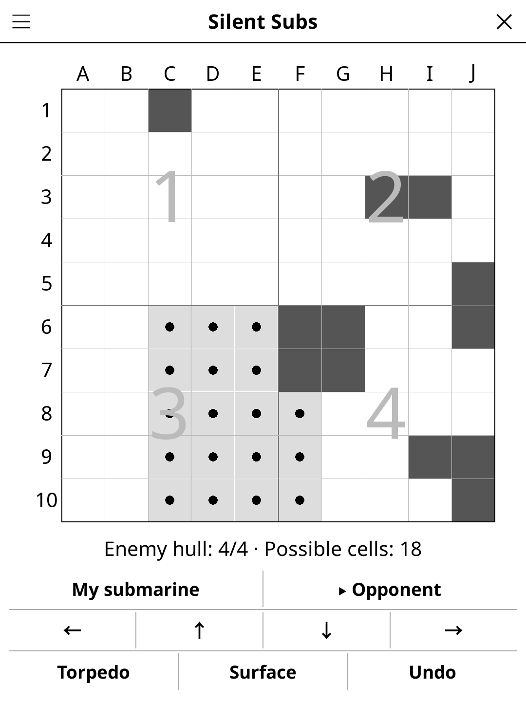

# stealthsubs.koplugin

**Silent Subs** (*Sous-marins furtifs*) is a hidden-movement duel for
[KOReader](https://github.com/koreader/koreader), played by two people with a
reader each. Both readers show the same sea; each player hides a submarine
and announces only part of what it does. Track the enemy and sink it first.

## How to play

1. One player opens **New game → Start a game** and reads the five-digit
   code aloud; the other opens **New game → Join a game** and types it.
2. Each player taps a water cell to hide their submarine, then **Dive**.
3. Take turns; each turn, do one thing and say it aloud:
   - **move** one cell with the arrows and say only the direction
     ("North!"); you cannot cross an island, leave the sea or go back over
     your own trail;
   - **torpedo** (after 3 moves since the last one) a water cell at most 3
     steps away, and say the cell; enter the answer your opponent gives;
   - **surface** to clear your trail, saying which quarter you are in.
4. Under **Opponent**, enter what your opponent says: their direction,
   their quarter, or the cell they fire at (your reader then gives you the
   answer to read out). The cells where they can still be are shaded.
5. A direct hit does 2 damage, a hit next to the submarine 1. Four damage
   sinks it — your own torpedoes included.

## Features

- **No connection needed** — both readers build the same sea from the code.
- **Honest answers** — each reader checks its own submarine's moves,
  torpedo range and damage.
- **Tracking** — every announcement narrows down where the enemy can be;
  shading can be turned off for a harder game.
- **Undo** — takes back the last thing entered.
- **Auto-save**; **Show the game code** reads it again.
- French, Spanish and German translations.

## Why e-ink friendly?

Turn-based, no animation: one repaint per announcement.

## License

GPL-3.0
